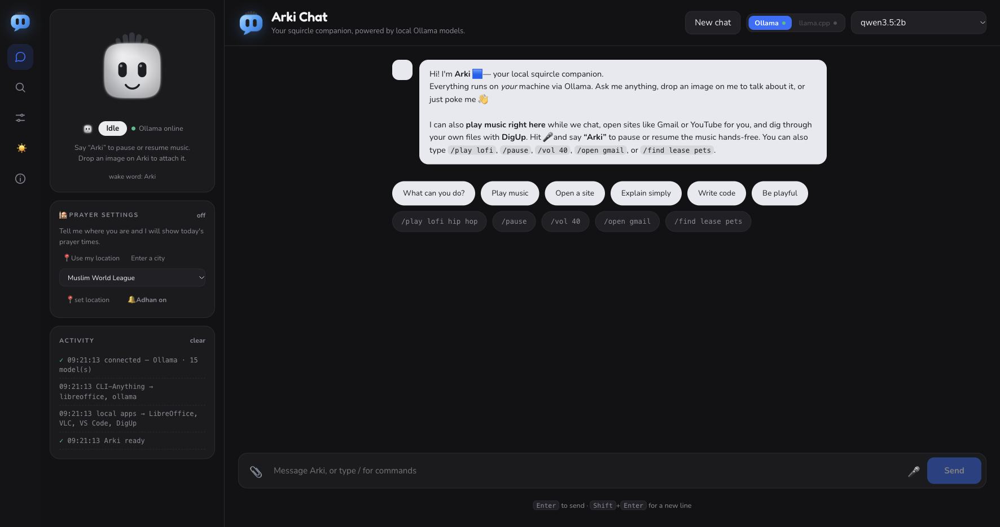
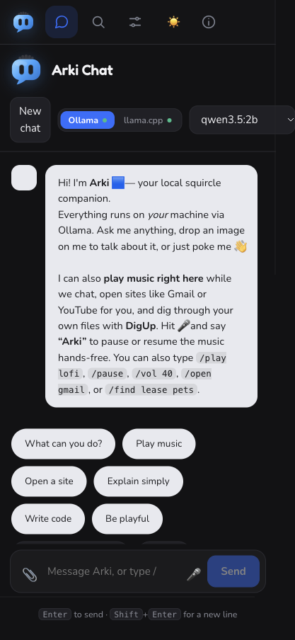
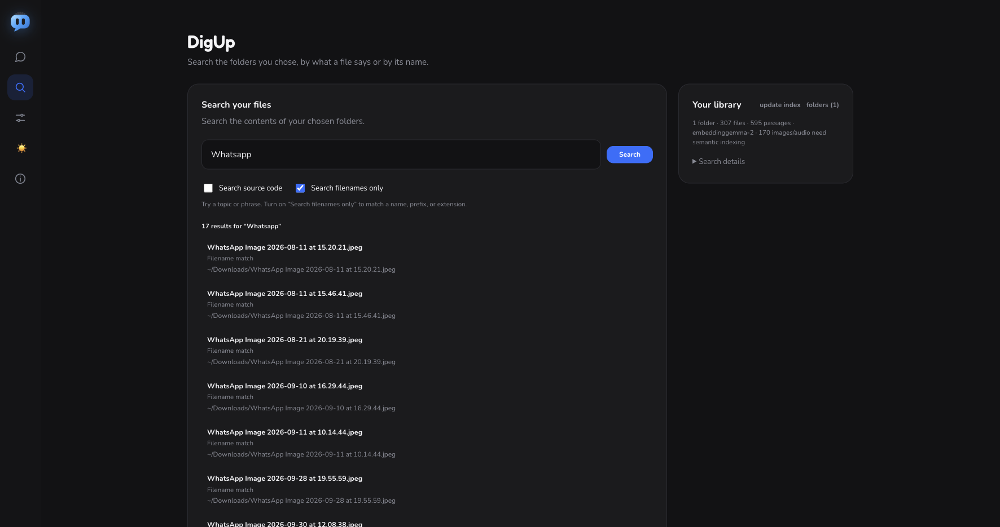
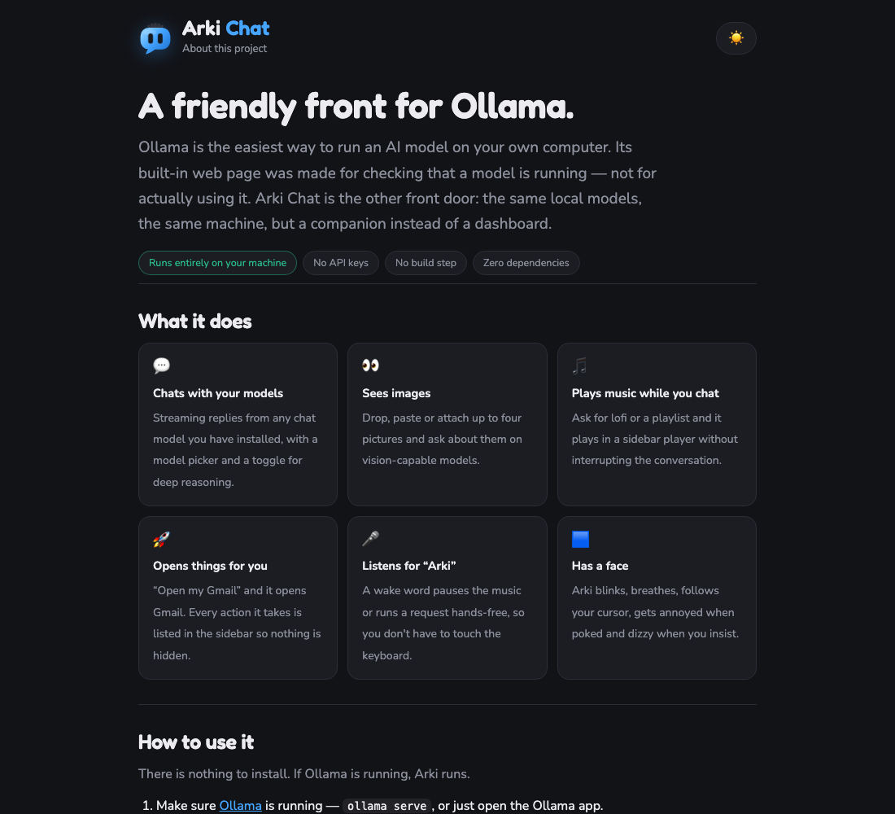
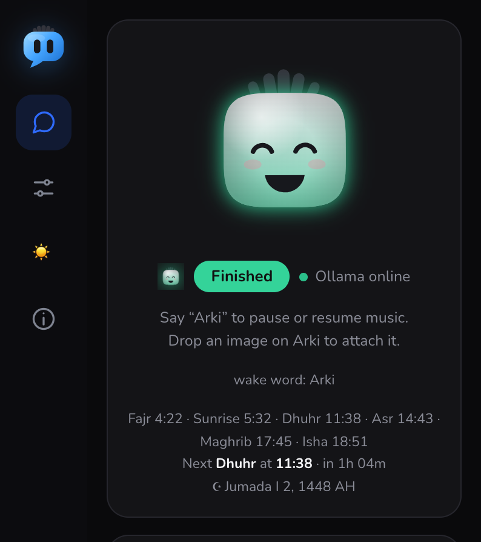

<div align="center">
  
</div>

# Arki Chat 🟦

Chatbot pendamping berbentuk squircle yang hidup di browser, sekaligus menjadi antarmuka yang lebih ramah untuk [Ollama](https://ollama.com) dan [llama.cpp](https://github.com/ggml-org/llama.cpp) — menjalankan model lokal yang sama, di mesin yang sama, tanpa dashboard developer. Setiap jawaban dibuat secara lokal: tanpa API key, tanpa cloud, tanpa proses build, dan **nol dependensi npm** untuk aplikasi chat itu sendiri. Pencarian file opsionalnya membutuhkan satu dependensi.

Namun Arki tidak hanya menjawab. Arki juga bisa **bertindak**: mencari YouTube dan memutar lofi melalui pemutar bawaan sambil kamu tetap mengobrol, membuka Gmail atau GitHub di tab untukmu, mencari isi file milikmu sendiri secara on-device dengan DigUp, serta mendengarkan kata pemicu **“Arki”** agar kamu bisa menjeda musik tanpa menyentuh keyboard.

> **Maintainer** — Adnuri Mohamidi

```bash
ollama serve        # 1. Ollama berjalan
node server.js      # 2. Arki (tidak perlu instalasi)
open http://localhost:5177
```



<p align="center">
  
</p>



<p align="center">
  
</p>

> 🌐 **Bahasa:** [English](README.en.md) · Bahasa Indonesia

---

## Daftar Isi

* [Mulai cepat](#mulai-cepat)
* [Mengapa](#mengapa)
* [Dua backend — Ollama dan llama.cpp](#dua-backend--ollama-dan-llamacpp)
* [Tools — Arki bisa bertindak](#tools--arki-bisa-bertindak)
* [Mencari file sendiri (DigUp)](#mencari-file-sendiri-digup)
* [Membuka aplikasi desktop](#membuka-aplikasi-desktop)
* [Mengendalikan fitur aplikasi dengan CLI-Anything](#mengendalikan-fitur-aplikasi-dengan-cli-anything)
* [Memutar musik di halaman](#memutar-musik-di-halaman)
* [Waktu salat](#waktu-salat)
* [Kata pemicu](#kata-pemicu)
* [Slash command](#slash-command)
* [Fitur chat](#fitur-chat)
* [Avatar](#avatar)
* [Suara](#suara)
* [Keyboard](#keyboard)
* [Responsif](#responsif)
* [Konfigurasi](#konfigurasi)
* [Cara kerjanya](#cara-kerjanya)
* [Apa yang diingat](#apa-yang-diingat)
* [Pemecahan masalah](#pemecahan-masalah)
* [Hal yang perlu diketahui](#hal-yang-perlu-diketahui)
* [Asal nama](#asal-nama)
* [Brand](#brand)
* [File](#file)
* [Kredit](#kredit)
* [Lisensi](#lisensi)

---

## Mulai cepat

### Yang perlu disiapkan

- **Node.js 18 atau lebih baru** untuk menjalankan Arki.
- **Ollama** dan satu model chat untuk jalur paling sederhana. llama.cpp juga bisa digunakan sebagai backend alternatif.
- **Node.js 22.13 atau lebih baru** hanya jika kamu ingin memakai DigUp, karena DigUp menggunakan `node:sqlite`.
- **Python 3.10 atau lebih baru** hanya jika kamu ingin memasang harness CLI-Anything untuk mengendalikan fitur aplikasi desktop.

Arki tidak membutuhkan instalasi dependensi npm di root proyek dan tidak memiliki proses build.

### Jalankan Arki

```bash
# 1. Instal Ollama dari https://ollama.com, lalu pastikan Ollama sedang berjalan
ollama pull qwen3.5:2b

# 2. Dari folder proyek, jalankan Arki
node server.js

# 3. Buka alamat yang dicetak server, biasanya http://localhost:5177
```

Kamu bisa menjalankan `ollama serve` di terminal terpisah jika Ollama belum berjalan sebagai service. Jika port 5177 sedang digunakan, Arki memilih port kosong berikutnya dan mencetak alamatnya di terminal. Baca [halaman About](about.html) untuk ringkasan fitur dan privasi.

### Aktifkan pencarian file DigUp (opsional)

DigUp perlu Node 22.13+ dan satu dependensi npm. Dari folder proyek:

```bash
npm install --prefix digup-js
ollama pull embeddinggemma-2
node server.js
```

Buka halaman **DigUp** dari ikon kaca pembesar di rail navigasi, tambahkan folder yang ingin dicari, lalu tunggu pengindeksan selesai. Pencarian semantik gambar juga memakai `embeddinggemma-2`. Folder baru tidak ditambahkan otomatis; hanya folder yang kamu pilih yang dibaca.

### Kendalikan fitur aplikasi desktop (opsional)

Arki bisa meluncurkan aplikasi desktop tanpa instalasi tambahan. Untuk menjalankan tindakan di dalam aplikasi, pasang harness CLI-Anything yang cocok dengan aplikasi tersebut. Contoh harness LibreOffice dan Ollama yang sudah diuji dengan Arki ada di [bagian CLI-Anything](#mengendalikan-fitur-aplikasi-dengan-cli-anything). Instalasi harness bersifat opsional; chat dan peluncur aplikasi tetap dapat digunakan tanpanya.

**Langkah opsional, tanpa Ollama:** pindah ke saklar **llama.cpp** di header, pilih GGUF yang sudah ada di mesinmu, lalu tekan **start llama.cpp** — Arki yang menyalakan `llama-server`, menunggu modelnya selesai dimuat, dan mematikannya lagi saat kamu berpindah.

Aplikasi chat tidak menginstal atau membangun apa pun. `index.html` adalah seluruh frontend; `server.js` adalah sekitar 1.800 baris server statis, proxy, peluncur aplikasi desktop, sekaligus manajer backend llama.cpp; `digup.js` menjembatani engine DigUp untuk pencarian file.

---

## Mengapa

Ollama adalah salah satu cara paling mudah untuk menjalankan model di komputer sendiri, dan perlahan menjadi otak lokal bawaan bagi banyak orang. Namun antarmuka web-nya tidak pernah benar-benar dibuat untuk *menggunakan* model — melainkan untuk *memeriksa* model. Parameter model, jumlah token, konsep berbentuk curl. Antarmuka tersebut sangat baik untuk menjawab pertanyaan “apakah model saya berjalan?”, tetapi kurang menjawab “sebenarnya saya ingin melakukan apa?”.

Arki Chat adalah pintu masuk alternatif. Model sama, komputer sama, privasi sama — tetapi dalam bentuk pendamping, bukan dashboard:

* **Siapa pun bisa memulai.** `ollama serve`, `node server.js`, selesai. Tidak perlu Docker, Python, mengunduh weights, atau file konfigurasi.
* **Tidak perlu memahami istilah teknis.** Kamu tidak memilih model berdasarkan jumlah parameter; cukup pilih model yang bekerja, dan Arki akan memberi tahu model mana yang dapat melihat gambar.
* **Arki melakukan sesuatu, bukan hanya menjawab.** Minta lofi dan Arki akan memutarnya sambil kamu terus mengobrol. Minta Gmail dan Arki akan membukanya.
* **Arki memberi tahu apa yang sebenarnya terjadi.** Setiap jawaban menyertakan model, waktu proses, dan kecepatan token. Setiap pemanggilan tool menunjukkan secara tepat apa yang dilakukan. Model lokal kecil memang tidak sempurna; Arki tidak menyembunyikannya.
* **Arki menyesuaikan diri.** Lebar 320px maupun 2560px — aplikasi tetap sama, dan versi ponselnya benar-benar merupakan versi utama.

Bagi siapa pun yang sudah nyaman bekerja di terminal, antarmuka Ollama sendiri tetap merupakan pilihan yang tepat. Arki ditujukan untuk orang yang sudah menjalankan Ollama tetapi belum yakin harus melakukan apa selanjutnya.

---

## Dua backend — Ollama dan llama.cpp

Di header ada satu saklar: **Ollama** · **llama.cpp**. Pilihan itu menentukan model mana yang muncul di dropdown, ke mana setiap pesan dikirim, dan tulisan pada banner status. Pilihan terakhir disimpan di `localStorage` (`arki.backend`) dan diingat server di `.arki-state.json` (sudah masuk `.gitignore`), jadi restart langsung menghangatkan backend yang sama.

**Ollama** adalah jalur default: `ollama serve`, pilih model, selesai.

**llama.cpp** menjalankan sebuah GGUF secara langsung, tanpa Ollama sama sekali. Dropdown-nya memuat setiap GGUF *chat* yang ada di mesin:

* blob milik Ollama (`~/.ollama/models`) — dipakai ulang apa adanya dan tetap memakai nama Ollamanya,
* `~/models`, `~/.local/share/models`, `/models`,
* `~/.cache/llama.cpp`, `~/.cache/huggingface/hub`, `~/.cache/lmstudio/models` (maksimal 3 level kedalaman).

Tekan **start llama.cpp** dan Arki yang menyalakan `llama-server` (`-m`, `--alias`, `--host 127.0.0.1`, port, `-ngl 99`), lalu menunggu modelnya siap — hingga 360 detik (`LLAMA_START_TIMEOUT`) — dan hanya melaporkan `ready` kalau memang siap. Di mesin CPU-only, memuat Q4 5 GB bisa makan waktu 1–4 menit; selama itu tombolnya menulis `starting…` alih-alih mengaku sudah jalan. Jika modelnya belum selesai dimuat, endpoint-nya menjawab `503 … still loading` yang jujur, bukan `ok:true`.

**Multimodal (gambar & audio).** llama.cpp memisahkan menara vision/audio ke file `mmproj` tersendiri. Letakkan `mmproj-*.gguf` di folder yang sama dengan modelnya (mis. `mmproj-gemma-4-E4B-it-Q8_0.gguf` di samping `gemma-4-E4B-it-Q4_K_M.gguf`) dan Arki menambahkan `--mmproj` sendiri — nama keluarganya dicocokkan dengan nama model. `LLAMA_MMPROJ` menimpanya. Tanpa file itu model tetap mengobrol, hanya tidak bisa melihat gambar atau mendengar audio.

**Port.** llama.cpp memakai `LLAMA_CPP_HOST` (default `127.0.0.1:8080`). Kalau port itu sudah dipakai (nginx, atau server milikmu sendiri), Arki berpindah ke port kosong berikutnya dan mencetaknya di log; server yang sudah ada tidak pernah disentuh, dan **stop llama.cpp** hanya mematikan server yang dia mulai sendiri.

**Apa yang tidak masuk daftar.** Model embedding, arsitektur yang tidak dikenal llama.cpp, dan GGUF *all-in-one* yang membawa encoder audio-nya sendiri (mis. `gemma4:latest` dari Ollama) sengaja disembunyikan — file terakhir itu gagal dimuat dengan `wrong number of tensors`. Model seperti itu tetap jalan melalui backend Ollama.

**Status.** `GET /api/inference/status` melaporkan kedua backend (`ollama.ok`, `llama_cpp.ok`), `GET /api/llama/models` mendaftar GGUF beserta yang sedang dilayani, dan halaman memakai keduanya untuk banner serta percobaan ulang tiap 5 detik.

---

## Tools — Arki bisa bertindak

Tool bawaan terhubung ke setiap request. Arki juga menambahkan tool `cli_anything` secara otomatis saat menemukan harness CLI-Anything yang terpasang. Ketika model memutuskan sebuah tool diperlukan, Arki menjalankannya, lalu mengirim hasilnya kembali kepada model.

| Tool            | Parameter           | Fungsinya                                                                                                                                                                                                                                                                                                                                            |
| --------------- | ------------------- | ---------------------------------------------------------------------------------------------------------------------------------------------------------------------------------------------------------------------------------------------------------------------------------------------------------------------------------------------------- |
| `play_music`    | `query`, `service?` | Mencari YouTube dan memutar hasil teratas di pemutar sidebar. Juga menerima URL YouTube, link atau URI track/album/playlist Spotify, maupun URL file audio langsung.                                                                                                                                                                                 |
| `control_music` | `action`            | `pause` · `resume` · `stop` · `next` pada pemutar sidebar.                                                                                                                                                                                                                                                                                           |
| `set_volume`    | `level`             | Mengatur volume di dalam halaman, 0–100. |
| `open_app`      | `name`              | Membuka situs di tab baru — gmail, youtube, github, drive, calendar, maps, netflix, reddit, wikipedia, x, notion, figma, amazon, chatgpt, claude, weather, news, npm, huggingface, dan lainnya, melalui 41 shortcut nama yang mencakup sekitar 37 situs. URL lengkap juga dapat digunakan; nama yang tidak dikenali akan dialihkan ke pencarian web. **Tool ini juga meluncurkan program desktop terpasang apa pun, berdasarkan nama** — di mesin tempat Arki berjalan. |
| `search_files`  | `query`, `code?`    | Mencari di dokumen, PDF, catatan, dan kode milikmu — serta nama file media — melalui indeks DigUp. Query dalam bahasa alami; `code: true` khusus kode sumber. Hasilnya berisi path, halaman/momen/baris yang cocok, dan cuplikan teks. |
| `cli_anything`  | `app`, `args`       | Hanya muncul jika ada harness CLI-Anything terpasang. Menjalankan perintah yang didukung harness tersebut, misalnya mengedit dokumen LibreOffice atau mengelola model Ollama. |

**Ke mana hasilnya ditampilkan.** Pemanggilan tool ditampilkan sebagai kartu di sidebar pada bagian *Tool activity* — termasuk argumen dan hasil aktual — dengan maksimum 8 aktivitas terakhir serta tombol **clear**. Transkrip percakapan tetap bersih; Arki hanya mengatakan apa yang dilakukannya dalam satu kalimat.

```text
kamu    ▸ Putarkan musik piano jazz yang tenang untuk saya
arki    ▸ Silakan — piano jazz yang lembut sedang diputar di sidebar.
          ⚡ play_music  query="calm jazz piano"
            Sekarang diputar di YouTube: “4K Cozy Coffee Shop with Smooth Piano
            Jazz Music…” oleh Relaxing Jazz Piano (3 jam, 35 menit).
```

**Detail yang perlu diketahui**

* Loop berjalan hingga **4 giliran** untuk setiap pesan, sehingga Arki dapat merangkai beberapa tindakan (memutar, lalu mengatur volume, lalu mengonfirmasi).
* Jika model menolak array `tools`, Arki mencatatnya lalu mencoba kembali giliran tersebut **tanpa tools**, alih-alih gagal. Chat tidak akan rusak karenanya.
* **6** tindakan terakhir dirangkum ke dalam system message, sehingga permintaan lanjutan seperti *“putar yang berikutnya”* atau *“kecilkan volumenya”* tetap dapat bekerja.
* Model lokal kecil sangat bersemangat membantu — model 2B mungkin memanggil `set_volume` sendiri. Deskripsi tool dan system prompt sama-sama secara eksplisit melarangnya, tetapi jika model mengabaikannya, kartu di sidebar akan menunjukkan secara tepat apa yang dilakukan.

**Pemanggilan tool membutuhkan model yang mendukung tool.** Telah diverifikasi bekerja dengan `qwen3.5:2b`, `granite4.2`, `gemma4`, `ornith-1.5:9b`, dan `Spark-X2.5-4B`. `phi4-mini` dan `gemma2:9b` mengabaikan tools dan hanya mengobrol — dengan model tersebut semuanya tetap dapat digunakan melalui slash command.

---

## Mencari file sendiri (DigUp)

Minta *“cari klausul tentang hewan peliharaan di lease-ku”* dan Arki dapat mencari di dalam file milikmu sendiri, bukan hanya di web. Ini adalah [digup-js](digup-js/), rebuild Node dari [DigUp](https://github.com/ARahim3/DigUp) yang dibundel di repo ini: satu indeks SQLite, pencarian hybrid vektor dan kata kunci, sepenuhnya di mesin ini.

```bash
npm install --prefix digup-js     # satu dependensi (fflate); Node 22.13+ untuk node:sqlite
node server.js
```

Buka halaman **DigUp** dari ikon kaca pembesar di rail navigasi, tekan **+ folder**, masukkan path folder, lalu biarkan ia mengindeks. Setelah itu tanyakan pada Arki di chat, gunakan kolom pencarian di halaman DigUp, atau ketik `/find <yang kamu ingat>`. Tool `search_files` mengembalikan nama file, path, halaman/momen/baris yang cocok, dan cuplikan; klik hasilnya untuk membukanya dengan aplikasi default. Pilih **Search filenames only** untuk mencocokkan nama, awalan, atau ekstensi di semua folder yang diindeks; mode ini mengembalikan semua nama yang cocok tanpa pemeringkatan isi file. Arki juga dapat menggunakan mode ini saat mencari file. Pencarian kode bersifat opt-in per folder: centang **Include source code in this folder** saat menambahkan proyek, lalu gunakan **Search source code**, `code:`, atau flag `code` pada tool.

Panel **Your library** menampilkan folder yang dicari dan memungkinkan penghapusan dari indeks tanpa menghapus file. Gunakan **update index** untuk menemukan file baru, memperbarui file yang berubah, atau menambahkan embedding semantik ke gambar lama. Gunakan **rebuild entire index** setelah mengganti model embedding. Progres dan pesan error dengan opsi pemulihan tampil di halaman DigUp; **Search details** menjelaskan kemampuan pencarian yang aktif. Hasil memuat cuplikan dan path lengkap. Tekan ↓ dari kolom pencarian, gunakan ↑/↓ untuk berpindah hasil, Enter untuk membuka, dan Escape untuk kembali ke query.

**Embedding berasal dari Ollama.** Tarik modelnya sekali dan Arki memakainya pada start berikutnya:

```bash
ollama pull embeddinggemma-2
```

`DIGUP_EMBED_MODEL` memilih model embedding Ollama lain. Model multimodal seperti `embeddinggemma-2` dapat meng-embed teks dan gambar dalam ruang semantik yang sama; DigUp memakai nama file sebagai fallback bila model tidak mendukung embedding media. Untuk memakai llama.cpp, set `DIGUP_MODEL` (dan `DIGUP_MMPROJ` untuk konten gambar/audio). Jika tidak ada model embedding yang tersedia, DigUp memakai pencarian leksikal tanpa model, yang lebih cocok untuk nama dan frasa persis daripada pencarian makna.

Indeksnya berada di `~/.digup/` (`DIGUP_HOME` dapat mengubahnya); tidak ada yang diunggah. DigUp tidak membaca folder tersembunyi, key, file password, atau placeholder cloud. `npm run digup -- list` menampilkan folder dan `npm run digup -- remove <folder>` mengeluarkannya dari indeks tanpa menyentuh file aslinya.

---

## Membuka aplikasi desktop

Halaman web tidak pernah bisa menjalankan program desktop — itu batasan semua aplikasi web, bukan khusus Arki. Jadi peluncurannya dilakukan oleh server:

| Endpoint | Fungsinya |
|---|---|
| `GET /api/apps` | shortcut terkurasi yang dikenal mesin ini; halaman membangun deskripsi tool `open_app` dari sana |
| `POST /api/launch` | body `{ "name": "vlc" }` → mencocokkan nama lalu menjalankan programnya |

**Nama apa pun bisa — LibreOffice, VLC, dan VS Code hanyalah contoh.** Sebuah nama ditempuh dengan urutan ini:

1. **Tabel terkurasi** di `server.js` — perintah terverifikasi per OS plus alias yang bersahabat (`vscode`, `vs code`, `code` → VS Code; `soffice` → LibreOffice). Terkurasi dulu, supaya `code` membuka VS Code dan bukan codepen.io.
2. **Situs yang dikenal** — `gmail`, `github`, dan `codepen` tetap membuka tab, seperti sebelumnya.
3. **Operating system-nya sendiri**, untuk apa pun selain itu — lihat tabel di bawah.
4. **Pencarian DuckDuckGo**, jika tidak ada yang terbuka, supaya kata yang tak dikenal tetap berguna.

`/open` menempuh urutan yang sama persis, tanpa melibatkan model.

| OS | Bagaimana OS mencocokkan nama yang tidak dikenal |
|---|---|
| macOS | `open -a "<nama>"` — LaunchServices, sehingga aplikasi terpasang apa pun bisa |
| Linux | `Name=`/`Exec=` dari file `.desktop` yang cocok, selain itu nama sebagai binary di `PATH` |
| Windows | `cmd /c start "<nama>"` — App Paths / Start Menu |

**Tidak ada yang lewat shell.** Setiap percobaan adalah array argv tetap yang diberikan ke `spawn()`, dan nama itu sendiri harus berupa huruf, angka, spasi, dan `.'+_ -` — tanpa pemisah path, tanpa tanda hubung di awal, dan tanpa karakter apa pun yang bisa dibaca `cmd.exe` sebagai sintaks — sehingga sebuah request tetap tidak bisa menyelipkan string perintah sembarang. Path Windows yang tidak terpasang dibuang sebelum percobaan pertama, sehingga instalasi sebagian tetap berfungsi.

**Ketika gagal, kamu tahu alasannya.** `Could not launch VLC — Unable to find application named 'VLC'` sampai ke kartu tool, model mengulanginya, dan chat tetap berjalan. Kata yang tak dikenal justru dialihkan ke pencarian web: *Could not launch “zzz” — …, so I searched the web for it instead.* Slash command melakukan hal yang sama tanpa melibatkan model: `/open vscode`.

**Program dijalankan pada mesin tempat `node server.js` berjalan**, yang belum tentu mesin tempat browser berada — perlu diingat jika kamu menyajikan Arki ke ponsel. Server ini secara desain tidak terautentikasi, sehingga apa pun yang bisa menjangkau port-nya bisa memintanya membuka aplikasi yang terpasang; sajikan hanya di jaringan yang kamu percaya.

**Menambahkan aplikasi bersifat opsional.** Entri `LOCAL_APPS` di `server.js` (`id`, `label`, `aliases`, `cmds` per platform) hanya layak ditulis untuk alias yang lebih bersahabat atau nama yang tidak dikenali sendiri oleh OS — Linux mengirim binary `libreoffice` sementara nama tampilannya "LibreOffice". Semuanya yang lain tanpa entri tetap berfungsi.

---

## Mengendalikan fitur aplikasi dengan CLI-Anything

`open_app` hanya membuka aplikasi. Untuk meminta Arki melakukan pekerjaan di dalam aplikasi, pasang CLI-Anything harness yang menyediakan perintah untuk aplikasi itu. Arki mencari executable bernama `cli-anything-*` di `PATH` dan di `.arki-tools/venv` milik proyek, lalu menambahkan tool `cli_anything` ke request model. Tool ini hanya muncul untuk harness yang ditemukan.

### Pasang harness yang cocok

Python 3.10+ diperlukan. LibreOffice juga harus sudah terpasang untuk harness LibreOffice. Harness Ollama memerlukan Git untuk mengambil paket dari repo CLI-Anything.

**macOS dan Linux** — jalankan dari folder proyek:

```bash
python3 -m venv .arki-tools/venv
.arki-tools/venv/bin/python -m pip install cli-anything-libreoffice
.arki-tools/venv/bin/python -m pip install 'git+https://github.com/HKUDS/CLI-Anything.git#subdirectory=ollama/agent-harness'
```

**Windows PowerShell** — jalankan dari folder proyek:

```powershell
py -3 -m venv .arki-tools/venv
.\.arki-tools\venv\Scripts\python.exe -m pip install cli-anything-libreoffice
.\.arki-tools\venv\Scripts\python.exe -m pip install 'git+https://github.com/HKUDS/CLI-Anything.git#subdirectory=ollama/agent-harness'
```

Perintah pertama membuat virtual environment proyek; dua perintah berikutnya memasang harness LibreOffice dan Ollama ke sana. `.arki-tools/` diabaikan oleh Git dan tidak mengubah instalasi Python global. Untuk memasang hanya satu harness, jalankan hanya baris `pip install` yang sesuai. Lihat [CLI-Anything](https://github.com/HKUDS/CLI-Anything) untuk daftar harness lain dan prasyarat masing-masing.

Setelah instalasi, mulai ulang `node server.js` dan muat ulang halaman Arki. Tool `cli_anything` akan tersedia untuk harness yang terpasang. Minta Arki menjalankan tugas yang kamu inginkan; jika belum tahu perintah harness, Arki dapat meminta `--help` terlebih dahulu.

Contoh kemampuan:

- **LibreOffice:** membuat dan mengedit dokumen, spreadsheet, dan presentasi, lalu mengekspornya ke PDF atau format Office.
- **Ollama:** mengelola model dan berinteraksi dengan service Ollama lokal.

Harness hanya menyediakan perintah yang dibuat untuk aplikasinya; pemasangannya tidak otomatis memberi kontrol ke semua aplikasi desktop. Perintah dijalankan pada mesin server Arki, tanpa shell, dan keluarannya dibatasi. Karena harness dapat mengubah file atau pengaturan aplikasi, jalankan Arki hanya pada komputer dan jaringan yang kamu percaya.

---

## Memutar musik di halaman

Pemutar berada di **sidebar**, tepat di bawah kartu Arki, sehingga musik tidak pernah mengganggu kolom percakapan.

```text
┌ NOW PLAYING ────────────────────── ✕ ┐
│  ┌────────────────────────────────┐  │
│  │           video 16:9           │  │
│  └────────────────────────────────┘  │
│  lofi hip hop radio 📚 beats to …    │
│  YouTube · pemutar dalam halaman     │
│  · Vol 80%                           │
│  ❚❚   ■   ────────●────   ▾   ↗      │
└──────────────────────────────────────┘
```

* ❚❚ / ▶ menjeda dan melanjutkan · ■ berhenti · slider volume · ▾ menyembunyikan video tetapi **tetap memutar audio** (diingat antar-sesi) · ↗ membuka sumber di tab · ✕ menutup
* Sidebar adalah **satu kolom kartu yang dapat di-scroll**: kartu Arki paling atas, lalu **Now playing**, **⚡ Tool activity**, **🕌 Prayer settings**, dan **Activity**. Kartu Now playing muncul di bawah Arki saat track pertama dimulai, sehingga menyalakan musik tidak pernah menggeser Arki keluar frame — hanya kartu-kartu di bawahnya yang bergerak.
* Avatar mendapatkan cahaya violet *Playing* setiap kali sebuah track dimulai.

**Dari mana audio berasal**

* **YouTube** — tidak memerlukan API key. YouTube telah menghentikan embed publik untuk fitur “search”, sehingga `server.js` menyediakan `/api/ytsearch`: fitur ini membaca halaman hasil pencarian normal sekali, mengambil ID video nyata beserta judul, channel, dan durasinya, lalu halaman melakukan embed terhadap hasil teratas menggunakan pemutar `youtube-nocookie`. Hasil disimpan di cache selama 10 menit.
* **Spotify** — link track, album, playlist, show, dan episode serta URI `spotify:` langsung di-embed ke halaman. Spotify tidak menyediakan *search* yang dapat di-embed, sehingga pencarian biasa (atau `service: "spotify"`) membuka `open.spotify.com/search/…` di tab baru dan Arki meminta kamu menempelkan link sebenarnya kembali untuk pemutaran di halaman.
* **File audio apa pun** — URL yang berakhiran `.mp3`, `.m4a`, `.aac`, `.ogg`, `.wav`, `.flac`, `.opus`, atau `.mp4` diputar melalui elemen `<audio>` native, yang kemudian dapat dijeda, dilewati, dan diatur volumenya oleh Arki seperti sumber lainnya.

> Browser memblokir autoplay tanpa suara sampai menganggap kamu sebagai pendengar yang aktif. Jika video tidak mulai sendiri, tekan ▶ sekali (atau klik di dalam pemutar) dan pemutar akan tetap berjalan.

---

## Waktu salat

Lima waktu salat harian dan matahari terbit, dihitung untuk lokasimu dan ditampilkan sesuai jam lokalmu. Semuanya dibaca sebagai **satu baris teks berjalan di bawah avatar** — tidak ada yang perlu dibuka atau diatur lebih dulu — dan fiturnya **aktif secara default**. Tombol **🕌 Prayer times** di Controls (atau tulisan kecil *off* di panel pengaturan) mematikannya, dan pilihan itu diingat.

```text
      Fajr 4:23 · Sunrise 5:33 · Dhuhr 11:40
      · Asr 14:43 · Maghrib 17:46 · Isha 18:52
      Salat berikutnya Maghrib 17:46 · dalam 1j 17m
      ☪ Jumada I 1, 1448 H
```

Baris itu berada di dalam kartu Arki sehingga tidak pernah mengambil ruang percakapan; kartu **🕌 Prayer settings** di sidebar menyimpan metode, lokasi, dan nada adzannya.

**Ia menanyakan lokasimu sekali saja.** Pada pemakaian pertama panel meminta izin lokasi ke browser (satu prompt, yang kemudian diingat browser). Jika ditolak, panel menawarkan **Enter a city** — ketik nama kota dan kota itu dicari melalui [Open-Meteo geocoding API](https://open-meteo.com/en/docs/geocoding-api), atau tempelkan `lat,lng` langsung untuk melewati jaringan sepenuhnya. Lokasinya disimpan secara lokal; pencarian hanya terjadi sekali dan tidak pernah diulang.

**Perhitungannya berjalan di sini, bukan di server.** Waktunya berasal dari algoritma PrayTimes.org yang sudah lama dikenal, diporting ke `index.html` sebagai JavaScript biasa — tanpa library, tanpa dependensi, tanpa API key, tanpa jaringan. Selisihnya sekitar satu menit dibanding library referensi `adhan` pada delapan kota dan empat tanggal. Di dalam lingkaran kutub, ketika matahari bisa saja tidak terbit atau tidak terbenam sama sekali, panel beralih ke lintang terdekat yang masih memiliki senja dan memberitahumu.

**Pilih metodemu.** Dropdown menyediakan Muslim World League (default), ISNA, Egyptian General Authority, Umm al-Qura (Makkah), Karachi, Tehran, dan Jafari. Asr memakai panjang bayangan standar (Syafi'i).

**Hitung mundur dan adzan.** Baris ini menyebutkan salat berikutnya dan menghitung mundurnya secara live. Saat waktu salat tiba, empat nada lembut berbunyi, Arki menyebutkan salat apa itu, dan kejadiannya tercatat di log — matikan dengan **🔔 Adhan**. Browser hanya mengizinkan audio setelah kamu berinteraksi dengan halaman, jadi klik di mana saja sekali jika nada pertama tidak terdengar.

**Arki bisa menjawab soal ini.** Tanya *“kapan Maghrib?”* dan tool `prayer_times` mengembalikan daftar hari ini beserta sisa waktu ke salat berikutnya.

---

## Kata pemicu

Klik **🎤 Wake “Arki”** untuk mulai mendengarkan (Chrome atau Safari, dan izin mikrofon akan diminta satu kali).

| Kamu mengatakan               | Arki melakukan                                                                   |
| ----------------------------- | -------------------------------------------------------------------------------- |
| *“Arki”*                      | menjeda musik — ucapkan lagi untuk melanjutkan                                   |
| *“Arki, putarkan bossa nova”* | menganggap bagian setelahnya sebagai permintaan dan menjalankannya melalui tools |
| *“Arki, pause that”*          | `"pause that"` dikenali sebagai slash command dan langsung dijalankan            |

Saat mendengarkan, Arki berubah menjadi cyan dengan status *Listening* dan menampilkan transkrip secara langsung sehingga kamu dapat melihat apa yang didengarnya. Klik `wake word: Arki` di bawah avatar untuk mengganti kata pemicu — bisa dengan kata apa pun, yang dicocokkan sebagai satu kata utuh.

Pengenalan suara menggunakan Web Speech API yang **disediakan oleh browser** (di Chrome, audio dikirim ke Google untuk transkripsi) dan hanya tersedia di Chromium dan Safari. Firefox dan browser lainnya akan mendapatkan pesan yang jelas di kartu Activity dan tombol akan otomatis dinonaktifkan. Slash command di bawah menyediakan fungsi yang sama tanpa mikrofon.

---

## Slash command

Perintah ini melewati model sepenuhnya dan langsung menjalankan tool — berguna untuk pengujian, browser tanpa dukungan speech, dan ketika kamu hanya ingin sesuatu berhenti.

| Command                    | Contoh                     |
| -------------------------- | -------------------------- |
| `/play <query>`            | `/play lofi hip hop beats` |
| `/pause` `/resume` `/stop` | `/pause`                   |
| `/next` atau `/skip`       | `/next`                    |
| `/vol <0-100>`             | `/vol 35`                  |
| `/open <app atau url>`     | `/open gmail`              |
| `/find <query>`            | `/find lease hewan`        |

---

## Fitur chat

* **Streaming reply** token demi token, dengan tombol **Stop** yang berfungsi serta timer langsung `thinking… 3s` / `writing… 4s`.
* **Statistik jawaban** di bawah setiap jawaban: model, waktu proses, jumlah token, dan tok/s.
* **Copy** saat hover untuk setiap jawaban; **Retry** jika terjadi kegagalan, yang mengembalikan prompt sebelumnya *beserta* gambarnya.
* **Pemilih model** yang menampilkan setiap model chat yang terinstal, dengan `📷` sebagai penanda model yang mendukung vision. Pilihan model akan diingat.
* **Vision** — seret gambar ke Arki, paste gambar, atau gunakan 📎. Maksimum 4 gambar per pesan, masing-masing 6 MB.
* **🧠 Deep toggle** — jawaban dikirim dengan `think:false` secara default karena model reasoning dapat menghabiskan 230 token untuk berpikir lalu tidak mengembalikan apa pun. Diukur pada mesin ini dengan prompt yang sama: **0,2 detik / 2 token dibandingkan 129 detik / 232 token dan jawaban kosong.** Aktifkan Deep ketika kamu menginginkan jawaban yang lebih lambat dan mendalam.
* **Starter prompt** pada percakapan kosong, serta tombol **↓ latest** ketika kamu sedang menggulir ke belakang.
* **New chat** menghapus transkrip dan memulai percakapan baru.
* **🕌 Waktu salat** untuk lokasimu, aktif secara default dan bisa dimatikan — teks berjalan di bawah avatar dengan hitung mundur salat berikutnya, tanggal Hijriah, dan nada adzan opsional. Lihat [Waktu salat](#waktu-salat).
* **🎭 Karakter sungguhan** — napas saat idle, kedipan (tunggal, ganda, dan mengantuk yang lambat), mata pada bola yang mengikuti kursor, tiga belas emote, sapaan ketika pertama kali dibuka, dan **28 suara buatan sendiri**. Lihat [Avatar](#avatar) dan [Suara](#suara).
* **Tema terang/gelap**, disimpan dan secara default mengikuti preferensi OS.
* **Rail navigasi** di tepi kiri — logo Arki (tautan kembali ke chat), **Chat**, **Controls** (membuka baris 🧠 Deep / Sound / 🕌 Prayer times), tombol tema, dan **About**. Membuka Controls tidak pernah mengatur ulang percakapan.
* **Activity** sebagai kartu di sidebar — setiap request, pemanggilan tool, wake word, dan error dengan timestamp, plus tombol **clear**. Daftarnya bergulir di dalam kartunya sendiri, jadi sepanjang apa pun isinya tidak pernah mengambil ruang percakapan.
* Bunyi retro opsional saat terjadi perubahan status.

---

## Avatar

Arki adalah karakter, bukan sekadar ikon. Ia **bernapas** dalam siklus lambat meskipun tidak ada apa pun yang terjadi — lebih dalam dan lebih cepat saat bekerja — dan ia **berkedip**: kedipan cepat, sesekali ganda, serta kedipan yang lebih berat ketika meja sudah sepi beberapa menit.

**Matanya berada pada sebuah bola.** Keduanya diproyeksikan ke bagian depan bola khayalan berukuran 97 unit: keduanya meluncur di permukaan itu ke arah kursor, mata yang jauh menyempit ketika berputar menjauh sementara yang dekat melebar, dan keduanya mengikuti naik-turunnya kursor. Sebuah kilau mengilap ada di setiap pupil, alis membawa suasana hati, dan mulut berubah bentuk antara senyum, cengiran, seringai, cemberut, huruf o, dan menguap. Sebuah poni geometris kecil — lima untaian membulat dengan bahasa bentuk yang sama seperti mata — bergerak mengikuti gerakanmu, menjadi rata ketika Arki berubah menjadi kotak untuk menelan file, dan bergerak liar di tengah emote. Ketuk avatar untuk mendapatkan komentar singkat; ketuk tiga kali dengan cepat untuk membuatnya pusing.

**Emote.** Tiga belas penampilan bernama — `wave`, `happy`, `love`, `wink`, `wow`, `laugh`, `proud`, `curious`, `shy`, `sad`, `angry`, `sleepy`, `dizzy` — masing-masing dengan mata, mulut, alis, gerakan tubuh, partikel, dan suaranya sendiri. Selama emote berjalan ia mengalahkan status. Itulah sebabnya sentuhan mendapat annoyed, tiga ketukan cepat mendapat dizzy, file yang jatuh mendapat hati, dan keheningan panjang mendapat menguap: biarkan mejanya lama tidak tersentuh dan kelopaknya menjadi berat, log mencatat `🥱 nothing for a while — Arki yawns`, dan Arki meregangkan mulutnya.

**Sapaan saat dibuka.** Hal pertama yang dilakukan halaman ini adalah menyapa — Arki melambaikan tangan, balon ucapan menyapamu dengan kata-kata, dan jika suaramu aktif, bunyi `hello` diputar (atau menunggu klik pertamamu, karena browser menahan audio sampai saat itu). Sekali per pemuatan, tidak pernah dua kali.



| Status                   | Warna        | Wajah                          | Gerakan                        | Kapan                                                       |
| ------------------------ | ------------ | ------------------------------ | ------------------------------ | ----------------------------------------------------------- |
| Idle                     | putih lembut | senyum                         | bernapas                      | tidak ada aktivitas                                         |
| Thinking                 | violet       | seringai, mata ke atas         | bergoyang pelan                | menunggu token pertama                                      |
| Working                  | biru         | datar                          | bergerak naik-turun            | sedang melakukan streaming jawaban                          |
| Searching                | indigo       | mata lebar                     | memindai pelan                 | sedang mencari sesuatu di YouTube                           |
| Finished                 | hijau        | cengiran                       | lompat dua kali, bintang       | jawaban selesai                                             |
| Error                    | merah        | cemberut, alis turun           | bergetar                       | Ollama tidak dapat dijangkau atau model mengalami kegagalan |
| Listening                | cyan         | dua titik, huruf o kecil       | berdenyut                      | mode hands-free aktif                                       |
| Playing                  | violet       | cengiran                       | menari                         | sebuah track baru saja dimulai                              |
| Annoyed / Dizzy          | —            | garis datar / spiral           | bergetar / bergoyang           | disentuh, diketuk tiga kali                                 |
| Upload                   | —            | celah kotak surat              | mengempis, menelan             | ada file yang dijatuhkan ke atasnya                         |

---

## Suara

**28 suara buatan sendiri**, semuanya disintesis di dalam halaman menggunakan osilator dan noise biasa — tanpa file suara, tanpa aset, tanpa apa pun untuk diunduh:

`hello` · `blip` · `hover` · `tick` · `pop` · `send` · `work` · `think` · `search` · `finish` ·
`error` · `annoyed` · `dizzy` · `slap` · `attach` · `gulp` · `open` · `close` · `love` ·
`proud` · `question` · `surprised` · `sleep` · `yawn` · `wink` · `approve` · `peek` · `rate`

Masing-masing adalah resep berlapis — gelombang yang meluncur dari satu frekuensi ke frekuensi lain, ledakan noise melewati pita yang menyapu, suara kedua yang sedikit berbeda nadanya, sebuah envelope — sehingga hasilnya *dituning*, bukan sekadar dibangkitkan: `finish` adalah arpeggio empat nada dengan kilau di atasnya, `gulp` adalah suara menelan rendah dengan napas setelahnya, `slap` adalah letupan noise di atas dentuman yang menurun, `yawn` adalah sapuan filter yang lambat. Status, emote, dan kejadian sehari-hari tersambung ke sana: pesan terkirim, kartu tool muncul, sentuhan, file yang dijatuhkan, panel kontrol dibuka, dan sapaan.

Suaranya **mati sampai kamu menyalakannya** lewat tombol **Sound** di Controls — pilihannya diingat, jadi pembukaan berikutnya juga menyapamu dengan suara. Dan semuanya milik Arki sendiri: file audio Coucou tidak dipakai dan tidak disalin (lihat [Kredit](#kredit)).

---

## Keyboard

| Tombol            | Fungsi                                     |
| ----------------- | ------------------------------------------ |
| `Enter`           | mengirim                                   |
| `Shift` + `Enter` | baris baru                                 |
| `Tab`             | menampilkan focus ring pada setiap kontrol |

Untuk menghentikan jawaban di tengah streaming, klik **■ Stop** (tombol Send berubah menjadi Stop selama proses pembuatan jawaban).

---

## Responsif

Arki telah diverifikasi dari ukuran **320×568 hingga 2560×1440**, termasuk tablet dalam orientasi portrait, laptop dengan browser chrome terbuka, dan ponsel dalam orientasi landscape.

| Lebar        | Layout                                                                    |
| ------------ | ------------------------------------------------------------------------- |
| ≥ 1181px     | rail ikon 72px + sidebar 326px + percakapan, berdampingan                 |
| 1025–1180px  | sidebar 296px                                                             |
| 861–1024px   | sidebar 270px dan Arki 150px                                              |
| ≤ 860px      | rail ikon menjadi baris horizontal di atas — satu kolom, percakapan dulu, lalu kartu-kartu sidebar |
| ≤ 560px      | header lebih kecil, tagline disembunyikan, Arki 120px, composer dipadatkan |

Tinggi layar ditangani secara terpisah karena jendela yang lebar tetapi pendek merupakan masalah yang berbeda:

| Tinggi           | Layout                                                |
| ---------------- | ----------------------------------------------------- |
| ≤ 720px (≥ 861px) | Arki 140px                                           |
| ponsel (stacked)  | composer tetap menempel di bagian bawah viewport      |

Chat mengisi ruang yang tersedia, bukan memperbesar diri mengikuti jumlah pesan, sehingga composer tidak pernah terdorong keluar layar. Rail ikon tidak pernah bergulir, sidebar bergulir sebagai satu kolom kartu, dan daftar aktivitas bergulir di dalam kartunya sendiri — sehingga sepanjang apa pun riwayatnya, ia tidak pernah mengambil ruang percakapan.

Semuanya menggunakan `dvh` dengan fallback `vh`, dan composer memberikan padding untuk home indicator iPhone.

---

## Konfigurasi

| Variabel      | Default                  | Fungsi                                         |
| ------------- | ------------------------ | ---------------------------------------------- |
| `PORT`        | `5177`                   | port HTTP; otomatis naik jika sedang digunakan |
| `OLLAMA_HOST` | `http://127.0.0.1:11434` | lokasi Ollama berjalan                         |
| `LLAMA_CPP_HOST` | `http://127.0.0.1:8080` | base URL llama.cpp; pindah otomatis ke port kosong berikutnya jika terpakai |
| `LLAMA_SERVER_BIN` | PATH / Homebrew | lokasi biner `llama-server` |
| `LLAMA_MMPROJ` | otomatis | paksa `--mmproj` tertentu; defaultnya mencari `mmproj-*.gguf` di folder model |
| `LLAMA_NGL` | `99` | GPU layers yang diteruskan ke `llama-server` |
| `LLAMA_CPP_ARGS` | — | argumen tambahan untuk `llama-server`, dipisah spasi |
| `LLAMA_START_TIMEOUT` | `360` | detik menunggu model siap pada start eksplisit |
| `LLAMA_CPP_MODEL` | — | GGUF yang didahulukan di daftar model (alias: `LLAMA_MODEL`, `MODEL_PATH`) |
| `DIGUP_ROOTS` | —                        | folder yang diindeks, dipisahkan delimiter path OS |
| `DIGUP_EMBED_MODEL` | `embeddinggemma-2` | model embedding Ollama |
| `DIGUP_OLLAMA_HOST` | `OLLAMA_HOST` | Ollama untuk embedding |
| `DIGUP_EMBEDDER` | otomatis | `ollama` / `hash`; otomatis memilih model Ollama yang sudah ditarik |
| `DIGUP_MODEL` | — | pakai GGUF embedding llama.cpp, bukan Ollama |
| `DIGUP_MMPROJ` | — | projector multimodal llama.cpp untuk gambar/audio |
| `DIGUP_EMBED_URL` | — | gunakan `llama-server --embeddings` yang sudah berjalan |
| `DIGUP_HOME`  | `~/.digup`               | lokasi indeks dan konfigurasi folder          |

```bash
PORT=8080 OLLAMA_HOST=http://192.168.1.10:11434 node server.js
```

Arahkan `OLLAMA_HOST` ke komputer lain di LAN untuk menggunakan GPU komputer tersebut sementara halaman tetap berada di komputer kamu. Hanya lakukan ini melalui jaringan yang kamu percaya — proxy sengaja tidak menggunakan autentikasi.

---

## Cara kerjanya

```text
browser  ──►  server.js  ──►  Ollama         (/api/chat, streaming NDJSON)
   │              │       └──►  llama-server  (/v1/chat/completions, -m model.gguf --mmproj …)
   │              ├──────►  youtube.com  (/api/ytsearch — halaman pencarian → video ids)
   │              ├──────►  CLI-Anything harness (fitur aplikasi terpasang)
   │              └──────►  ~/.digup/index.sqlite  (pencarian file DigUp)
   │
   └── iframe ──► youtube-nocookie.com / open.spotify.com
```

**`server.js`** menyajikan halaman dan menghubungkan layanan lokal:

1. menyajikan file statis dari direktorinya sendiri (dengan perlindungan terhadap path traversal)
2. melakukan proxy terhadap setiap request `/api/*` ke backend yang dipilih (Ollama atau llama.cpp), menerjemahkan protokolnya, dan melakukan streaming langsung — ini hanya diperlukan untuk menghindari CORS browser
3. menyediakan `/api/ytsearch`, yang mengambil halaman pencarian YouTube dan mengekstrak hingga 5 hasil, dengan cache selama 10 menit
4. mendengarkan pada `PORT`, menaikkan port satu per satu jika port tersebut sedang digunakan
5. menjawab `GET /api/apps` dan `POST /api/launch` untuk membuka aplikasi desktop, lihat [Membuka aplikasi desktop](#membuka-aplikasi-desktop)
6. menemukan harness CLI-Anything dan menjalankannya melalui `/api/cli-anything*`, lihat [bagian CLI-Anything](#mengendalikan-fitur-aplikasi-dengan-cli-anything)
7. menyediakan `/api/digup*` untuk pencarian file, memuat `digup-js` secara lazy dan menjaga indeks tetap siap
8. mengelola siklus hidup llama.cpp sendiri: memindai GGUF di mesin (`/api/llama/models`), menyalakan `llama-server` dengan `--mmproj` yang benar (`/api/llama/start`), mematikan hanya server yang dia mulai sendiri (`/api/llama/stop`), dan melaporkan kedua backend di `/api/inference/status`

**`index.html`** adalah seluruh frontend — engine avatar pada canvas, UI chat, renderer markdown-lite, definisi tool, loop pemanggilan tool, player, dan wake word. Sebagian besar tool dijalankan di browser; `search_files` dan `cli_anything` memakai server lokal untuk mengakses indeks dan aplikasi yang berada di mesin itu.

**Manajemen konteks:** transkrip dibatasi hingga 40 pesan, dan 20 pesan terakhir dikirim ke model. Pesan assistant yang terpisah di awal akan dipangkas agar pasangan user/assistant tidak pernah terbelah. Field yang hanya digunakan oleh client tidak pernah meninggalkan browser.

---

## Apa yang diingat

Disimpan di `localStorage`, semuanya menggunakan prefix `arki.`:

| Key              | Isi                                       |
| ---------------- | ----------------------------------------- |
| `arki.model`     | model yang dipilih                        |
| `arki.backend`   | backend aktif: `ollama` atau `llama.cpp`  |
| `arki.think`     | Deep aktif/nonaktif                       |
| `arki.theme`     | light / dark                              |
| `arki.vol`       | volume player                             |
| `arki.dockVideo` | preview video ditampilkan atau audio-only |
| `arki.wake`      | kata pemicu                               |
| `arki.prayer`    | panel waktu salat aktif/nonaktif          |
| `arki.pLat` / `arki.pLng` / `arki.pCity` | lokasi waktu salat     |
| `arki.pMethod`   | metode perhitungan waktu salat            |
| `arki.pAdhan`    | nada adzan aktif/nonaktif                 |

Percakapan itu sendiri **tidak disimpan secara permanen**. Selain indeks DigUp opsional di `~/.digup` (hanya ditulis saat kamu menambahkan folder) dan `.arki-state.json` (satu baris: backend terakhir dan modelnya, sudah masuk `.gitignore`, sehingga restart bisa langsung menghangatkan backend yang sama), tidak ada yang ditulis ke disk — setelah reload kamu akan memulai dari awal. Server hanya mencetak beberapa baris saat startup (URL Arki dan status kedua backend) dan tidak pernah mencatat isi request atau pesan.

---

## Pemecahan masalah

**“Can't reach Ollama”** — banner di atas composer berarti server tidak dapat terhubung ke Ollama. Pastikan `ollama serve` sedang berjalan dan `OLLAMA_HOST` sesuai dengan lokasi Ollama benar-benar mendengarkan. Aplikasi akan mencoba kembali setiap 5 detik secara otomatis.

**Tidak ada model di dropdown** — jalankan `ollama pull qwen3.5:2b` (atau model chat apa pun) untuk memasang model.

**“llama.cpp isn't serving yet”** — kamu berada di backend llama.cpp tetapi belum ada model yang dijalankan. Pilih GGUF di dropdown lalu tekan **start llama.cpp** (atau jalankan sendiri `llama-server -m model.gguf`), atau pindah kembali ke saklar Ollama. Banner dicoba ulang tiap 5 detik dan hilang begitu modelnya menjawab.

**Model llama.cpp lama sekali / “still loading”** — pemuatan bergantung pada CPU dan RAM; Q4 5 GB bisa makan waktu 1–4 menit di mesin CPU-only. Start eksplisit menunggu hingga 360 detik (`LLAMA_START_TIMEOUT`); kalau lewat batas, Arki menjawab `503 … still loading` dengan jujur dan membiarkan server menyelesaikan pemuatannya — coba kembali satu menit kemudian.

**`wrong number of tensors` / model hilang dari daftar llama.cpp** — GGUF *all-in-one* yang membawa encoder audio-nya sendiri (mis. `gemma4:latest` dari Ollama) tidak bisa dimuat `llama-server`. Daftar llama.cpp menyembunyikannya dengan sengaja; pakai backend Ollama untuk model seperti itu.

**Port 8080 sudah terpakai** — bukan error. llama.cpp memakai 8080 lalu pindah ke port kosong berikutnya bila ada yang sudah mendengar di sana; cek log `llama.cpp  →  port 8080 is in use, using … instead`.

**Model llama.cpp tidak bisa melihat gambar** — multimodal butuh file `mmproj-*.gguf` di folder yang sama dengan modelnya; tanpa itu chat tetap jalan tetapi gambar diabaikan. `LLAMA_MMPROJ=/path/mmproj.gguf` menimpanya secara manual.

**Jawaban kosong dari model reasoning** — ini memang dapat terjadi, dan merupakan alasan `think:false` menjadi default. Aktifkan **🧠 Deep** lalu coba lagi.

**Jawaban pertama sangat lambat** — model sedang dimuat ke memori. Model kecil membutuhkan beberapa detik, sedangkan model besar dapat membutuhkan hingga sekitar 30 detik. Timer di bawah jawaban menunjukkan proses tersebut; jawaban kedua akan langsung muncul.

**Tools tidak pernah berjalan** — kemungkinan model kamu tidak mendukung tool calling. Coba `granite4.2` atau `gemma4`, atau gunakan `/play` dan `/open`.

**Tool `cli_anything` tidak muncul** — pastikan harness terpasang di `.arki-tools/venv` atau `PATH`, lalu mulai ulang `node server.js` dan muat ulang halaman. Harness hanya menyediakan kemampuan yang memang didukungnya; lihat `--help` untuk daftar perintah.

**🎤 tidak melakukan apa-apa** — Web Speech tidak didukung browser kamu (Firefox), atau izin mikrofon ditolak. Gunakan slash command.

**Video tidak melakukan autoplay** — ini disebabkan kebijakan autoplay browser. Tekan ▶ sekali.

---

## Hal yang perlu diketahui

* Player YouTube dan Spotify merupakan iframe pihak ketiga. Keduanya membutuhkan internet dan menggunakan cookie mereka sendiri; prompt kamu tidak pernah dikirim kepada mereka.
* Web Speech API melakukan transkripsi di browser. Di Chrome, ini berarti audio dikirim ke Google selama sesi pengenalan berlangsung. Selain itu — chat, tools, dan musik — tetap lokal.
* Model lokal kecil bagus dalam *memanggil* tools tetapi kurang bagus dalam *menahan diri*. Log kartu Arki tersedia agar kamu selalu dapat melihat secara tepat apa yang terjadi.
* YouTube dapat mengubah markup halaman hasil pencarian, yang dapat menyebabkan `/api/ytsearch` rusak. Jika hal tersebut terjadi, `/play` akan beralih membuka halaman pencarian di tab baru daripada gagal.
* Arki hanya menghentikan server llama.cpp yang dia mulai sendiri. Server yang sudah berjalan di `LLAMA_CPP_HOST` — milikmu — tidak pernah disentuh: kalau portnya terpakai, Arki pindah ke port lain.
* Meluncurkan aplikasi desktop menjalankan satu perintah tetap yang divalidasi di mesin yang menjalankan `server.js`. Sebuah nama harus berupa huruf, angka, spasi, dan `.'+_ -`, dan tidak ada yang pernah lewat shell, sehingga sebuah request tidak bisa mengeksekusi string perintah sembarang.

---

## Asal nama

**Arki** adalah gabungan nama anak saya: **Arvin** dan **Wiki**— dua nama, satu pendamping yang hidup di browser, dan satu kata pemicu yang mudah diucapkan.

---

## Brand

`logo.svg` adalah keseluruhan identitas visual: speech bubble biru berbentuk squircle yang membawa dua mata berbentuk pill milik Arki dan poni kecilnya — squircle *adalah* Arki, bubble *adalah* chat. Hanya menggunakan beberapa bentuk dan satu gradient, tanpa font dan tanpa dependensi, sehingga aman untuk di-inline, diberi warna ulang, atau diperbesar maupun diperkecil ke ukuran apa pun. Tetap mudah dibaca hingga ukuran 16px.

Di dalam aplikasi, logo muncul dua kali: sebagai ubin 38px di puncak rail navigasi (tautan kembali ke chat) dan sebagai lockup 46px di samping wordmark pada header percakapan, yang berkedip sekali setiap 7,5 detik. `logo.svg` juga berfungsi sebagai favicon.

---

## File

```text
logo.svg       Identitas visual Arki Chat (juga favicon)
server.js      Static server + proxy backend + /api/ytsearch + peluncur aplikasi + manajer llama.cpp + API DigUp
cli-anything.js Pencarian harness CLI-Anything dan eksekusi perintah tanpa shell
index.html     Avatar engine (inspirasi Coucou) + 28 suara, UI chat, tools, player dan wake word
about.html     Halaman About — apa itu Arki, privasi, kredit dan lisensi
digup.js       Jembatan yang memuat engine DigUp secara lazy untuk /api/digup*
digup-js/      Engine pencarian file on-device (SQLite + embedding), MIT
screenshots/   Gambar yang digunakan dalam file ini
package.json   Metadata + skrip opsional `digup:install` dan `digup`
test/          Tes integrasi DigUp UI dan bridge CLI-Anything
```

**Halaman About** — `about.html` adalah penjelasan yang ditujukan untuk manusia: apa itu Arki, quickstart empat langkah, penjelasan privasi secara jujur, kredit, dan lisensi. Halaman ini ditautkan dari header dan dibuka di tab baru agar percakapan tidak pernah terganggu. Halaman ini juga berbagi key `arki.theme`, sehingga selalu mengikuti pengaturan tema terang/gelap pada chat.

---

## Kredit

Dibuat dan dipelihara oleh **Adnuri Mohamidi**.

### Avatar

Engine avatar squircle Arki — tubuh superellipse, mata yang diproyeksikan pada bola dan mengikuti kursor, kedipan, napas saat idle, reaksi ketika disentuh/diganggu/pusing, serta perubahan bentuk menjadi kotak ketika file dijatuhkan — terinspirasi oleh **Mochi**, karakter dari **[Coucou](https://github.com/Louis-CFM/coucou)** karya Louis Raillé.

Coucou menggunakan lisensi MIT, dan engine Arki merupakan implementasi ulang JavaScript dari ide-ide tersebut untuk browser — napas, kedipan, mata pada bola, reaksi sentuh/gangguan/pusing, emote, dan sapaan saat dibuka. Terima kasih kepada Louis karena telah membuatnya terbuka.

Namun **suaranya tidak**: paket suara Mochi adalah © Louis Raillé di bawah lisensi aset Coucou, jadi Arki tidak menyertakan satu pun. Ke-28 suaranya dibuat dari nol di `index.html` menggunakan osilator dan noise biasa (lihat [Suara](#suara)).

Semua hal lainnya dalam Arki Chat — layout, sistem tool-calling, player sidebar, wake word, desain responsif, poni Arki, dan `logo.svg` — merupakan karya asli proyek ini.

### Juga menggunakan

* [DigUp](https://github.com/ARahim3/DigUp) oleh ARahim3 — arsitektur di balik pencarian file on-device `digup-js`
* [Ollama](https://ollama.com) — menjalankan setiap model secara lokal dan melakukan proses reasoning sebenarnya
* [llama.cpp](https://github.com/ggml-org/llama.cpp) — engine opsional yang menyajikan GGUF langsung, termasuk `--mmproj` untuk gambar dan audio
* [Fredoka](https://fonts.google.com/specimen/Fredoka) & [Nunito](https://fonts.google.com/specimen/Nunito) — font
* YouTube dan Spotify — player yang di-embed di sidebar

---

## Lisensi

Arki Chat dirilis berdasarkan [MIT License](https://opensource.org/licenses/MIT).

Proyek ini mencakup karya yang berasal dari [Coucou](https://github.com/Louis-CFM/coucou), yang juga menggunakan lisensi MIT. Pemberitahuan asli direproduksi di bawah ini karena diwajibkan oleh lisensinya:

```text
MIT License
Copyright (c) 2026 Louis Raillé

Permission is hereby granted, free of charge, to any person obtaining a copy
of this software and associated documentation files (the "Software"), to deal
in the Software without restriction, including without limitation the rights
to use, copy, modify, merge, publish, distribute, sublicense, and/or sell
copies of the Software, and to permit persons to whom the Software is
furnished to do so, subject to the following conditions:

The above copyright notice and this permission notice shall be included in all
copies or substantial portions of the Software.

THE SOFTWARE IS PROVIDED "AS IS", WITHOUT WARRANTY OF ANY KIND, EXPRESS OR
IMPLIED, INCLUDING BUT NOT LIMITED TO THE WARRANTIES OF MERCHANTABILITY,
FITNESS FOR A PARTICULAR PURPOSE AND NONINFRINGEMENT. IN NO EVENT SHALL THE
AUTHORS OR COPYRIGHT HOLDERS BE LIABLE FOR ANY CLAIM, DAMAGES OR OTHER
LIABILITY, WHETHER IN AN ACTION OF CONTRACT, TORT OR OTHERWISE, ARISING FROM,
OUT OF OR IN CONNECTION WITH THE SOFTWARE OR THE USE OR OTHER DEALINGS IN
THE SOFTWARE.
```

